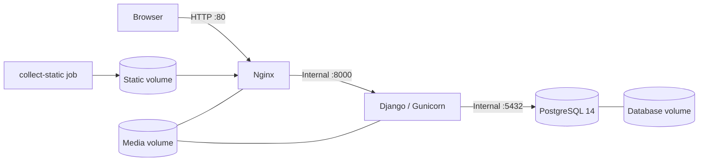

# DevOps overview

Scope: Docker Compose deployment and GitHub Actions CI. Configuration reviewed on
2026-11-19; running environments and operational procedures remain unverified.

## Operations entry points

| Task | Guide |
| --- | --- |
| CI workflows, execution environments, permissions, and diagnostics | [Continuous integration](ci.md) |
| Configure an environment, deploy, release, or assess rollback | [Deployment](deployment.md) |
| Create a database archive or rehearse restoration | [Backup and restore](backup-and-restore.md) |
| Check services, inspect logs, or investigate failures | [Maintenance](maintenance.md) |

## Deployment model

The [Compose file](../../docker/docker-compose.yml) also publishes database port
`5432` on the host. The diagram shows application traffic; host exposure must be
considered separately from the internal service network.

| Component | Responsibility | Persistent storage |
| --- | --- | --- |
| `nginx` | HTTP proxy; static and media responses | Reads static and shares media volumes |
| `web` | Configuration validation, migration, then Gunicorn | PostgreSQL and media volume |
| `db` | PostgreSQL database | `postgres_data` at `/var/lib/postgresql/data/` |
| `collect-static` | One-shot static asset collection before Web starts | Writes `static_volume` |
| `init-admin` | Optional one-shot Django superuser creation | Writes to the database; `admin` profile |

Compose prefixes volume names with its project name. Changing that name or moving
the checkout can select different volumes. Record the existing project identity
before a release or recovery operation. Static assets can be regenerated; database
and uploaded media require separate protection.

The [Web entrypoint](../../entrypoint.sh) runs migrations before starting Gunicorn.
A container restart can therefore change the database schema. The
[`/health/` endpoint](../../menu_management/views.py) returns `ok` without querying
the database; it does not prove business operations or recovery.

## Environment status

| Area | Repository evidence | Environment confirmation required |
| --- | --- | --- |
| Runtime | Python 3.12 image, Gunicorn, production settings | Deployed revision and image identities |
| Networking | Nginx on host port 80; DB on host port 5432 | Firewall, external reachability, domain |
| TLS and cookies | No TLS listener; secure cookie flags and SSL redirect disabled | Public HTTPS configuration and checks |
| Secrets | Runtime `.env`; optional root `.env.admin` | Secret ownership, access, and recovery location |
| Data | Database, static, and media volumes | Actual volume names, size, and storage location |
| Backups | No backup script or scheduler checked in | Host jobs, destination, retention, restore evidence |
| Releases | CI checks; no deployment workflow | Actual release process and responsibility |
| Monitoring | Container healthchecks and health route | External checks, alerts, response responsibility |

The `production` settings name does not establish public deployment readiness.
Production host details, DNS, TLS, backups, and ownership cannot be inferred from
the repository. Record those facts in the deployment's restricted inventory after
verification.
